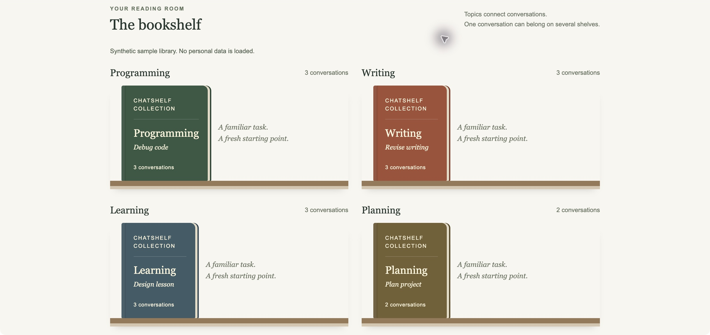
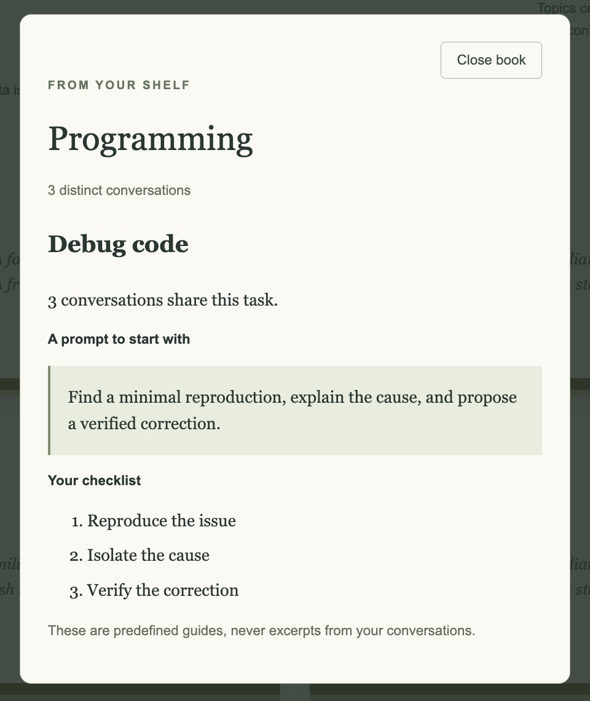
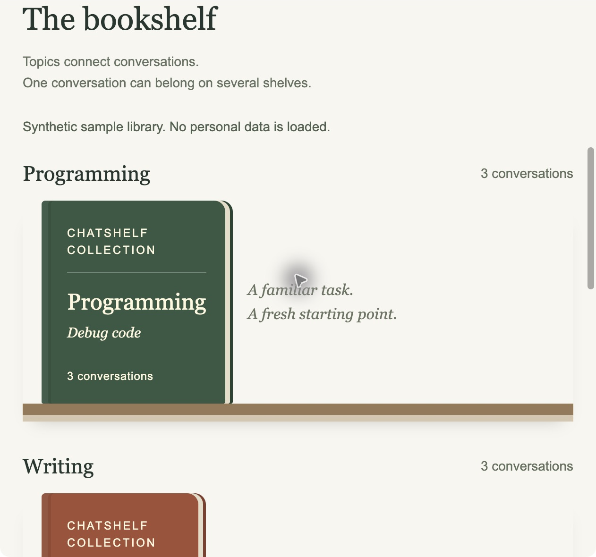

# ChatShelf

**Good conversations deserve a shelf.**

ChatShelf turns recurring themes in your ChatGPT conversations into a personal bookshelf. See what you return to, open a book for a practical starting prompt, and bring a little structure to your next coding, writing, teaching or planning session.

**[Download ChatShelf v0.1.0](https://github.com/obscrivn/chatShelf/releases/download/v0.1.0/ChatShelf.html)** · [Release notes](docs/RELEASE_NOTES.md) · [Verify your download](https://github.com/obscrivn/chatShelf/releases/download/v0.1.0/SHA256SUMS)

Save the HTML file and open it in **Chrome**. No installation, account, server, API key or internet connection is needed to use it.



## Find patterns. Start with a plan.

For developers revisiting debugging problems, writers refining drafts, educators preparing lessons and anyone organizing projects, ChatShelf offers three simple benefits:

| What you want | What the bookshelf gives you |
| --- | --- |
| See the themes you keep returning to | Four familiar topic shelves connect conversations across projects. One conversation can belong to several shelves. |
| Make a recurring task easier to start | Open a book for a predefined prompt and an actionable three-step checklist when the task appears in at least two distinct conversations. |
| Explore without uploading your history | Classification runs locally in your tab; the app displays only approved labels, general guides and counts. Reimport when you need it. |

## A quick visual tour

### 1. See your recurring themes at a glance

The books above show a synthetic sample library. Conversation counts help you spot repeated activity across **Programming, Writing, Learning and Planning**. The sample is available immediately through **Explore a sample library**, so you can try the experience before importing anything.

### 2. Open a book. Get a starting point.

A recurring debugging task becomes a reusable prompt and checklist: reproduce the issue, isolate the cause, verify the correction. Use the guide as a starting point for your next conversation or work session. These guides are fixed templates, never excerpts or summaries of your imported conversations.



### 3. Keep your bookshelf within reach

The shelves adapt to a narrow browser window, making it easy to browse beside your work. Select a book to explore; choose **Clear session** when you finish. The next session begins with a fresh import.



All screenshots show **synthetic sample data only**. The overview and book-detail images were captured from the released HTML in Chrome; the narrow view comes from the earlier browser verification of the unchanged UI. Browser chrome has been cropped out.

## Try it in five steps

1. **Download and open** [ChatShelf.html](https://github.com/obscrivn/chatShelf/releases/download/v0.1.0/ChatShelf.html) locally in Chrome.
2. **Explore a sample library** to see the bookshelf with synthetic data.
3. **Import JSON files** from a ChatGPT export you have extracted locally. Select split conversation files together: up to 20 files, 10 MB each. ZIP and HTML input are unsupported.
4. **Open a book** for its topic count and, where a recurring task is detected, its general prompt and checklist.
5. **Clear session** when finished. Reloading or reopening also requires a fresh import.

ChatShelf groups topics and tasks; it does not reopen original chats or search their raw contents. Only four approved topics and one approved task per topic are supported in this release.

## Private by design, with clear limits

The application makes no runtime network requests and uses no application storage, telemetry or external assets. Raw conversation titles, IDs, text and filenames are never rendered. Labels and guides come from a fixed approved catalog; imported project names cannot become book titles.

Sensitive and unknown content may be excluded. Sensitive detection is a finite English keyword heuristic: it can miss oblique or other-language content and suppress benign text. Categories and counts can still reveal broad activity. JavaScript memory is not securely erased, and browser extensions and operating-system file recents are outside the app's boundary.

## Parsing decisions: why your shelf looks the way it does

ChatShelf favors conservative evidence over guessing. These choices keep topic discovery predictable and prevent imported text from becoming output labels.

| Decision | How it works and why |
| --- | --- |
| Follow the active conversation branch | The parser follows `current_node` through parent links in `mapping`. It ignores abandoned branches instead of guessing which leaf represents the conversation. |
| Learn from user requests | Only plain-text user messages provide evidence. Assistant, system, developer and tool messages are excluded; unsupported multimodal user payloads exclude that record. This avoids treating an assistant's suggestions as the user's recurring work. |
| Preserve turn boundaries | Topic evidence can accumulate across user turns, but task verbs and topic words must occur together in an affirmative clause within one turn. An unrelated later request cannot supply the missing task verb. |
| Count conversations, not repeated words | Each accepted conversation ID counts once per topic/task. Identical active user-turn sequences sharing an ID count once; differing sequences with the same ID are quarantined. Identical text under different IDs counts as separate conversations. |
| Allow more than one topic | Each topic is scored independently using a controlled vocabulary and at least two distinct matching words. Evidence for Writing does not dilute evidence for Programming. |
| Abstain on ambiguity | Negated, quoted and hypothetical clauses do not establish a recurring task. This reduces some false labels, but can also miss legitimate requests; it is a heuristic rather than full language understanding. |
| Screen sensitivity first | Sensitive keyword matches suppress the conversation before topic assignment. This screening is incomplete; it is separate from the structural guarantee that raw imported strings never become labels or guides. |
| Reject unsupported structure | Arrays of mapping records, single mapping records and `{conversations: [...]}` envelopes are supported. Missing parents, cycles, inconsistent IDs and malformed authors exclude records. Flat message lists, ZIP and HTML are not inferred or executed. Valid records may still be analyzed alongside excluded ones. |
| Keep failures and resource use bounded | Malformed JSON, file-size and file-count violations return fixed statuses without imported details. Limits also include 10,000 records, 2,000 active nodes and 100,000 user-text characters per conversation. Large valid inputs can still pause synchronous parsing. |

Titles and metadata never supply classification evidence. Supported wrappers are defensive adapters, not a promise that every past or future export schema is compatible. See [architecture](docs/ARCHITECTURE.md) and [export compatibility research](docs/EXPORT_RESEARCH.md).

## Built for the OpenAI Ten Prompt Build Dev Challenge

ChatShelf is part of the **OpenAI Ten Prompt Build Dev Challenge**: build something useful with Codex in ten prompts or fewer. The ten cover the **whole project across Codex and ChatGPT, from planning to debugging**.

ChatGPT helped shape the scope, privacy contract and implementation handoff. Codex implemented the offline engine and bookshelf, exercised synthetic tests and Chrome checks, revised ambiguous classification and parsing after critical review, and packaged the GitHub release. The final challenge documentation adds this visual product guide without changing the application design.

Prompt accounting is an estimate, not a verified compliance claim: the [project tracker](docs/PROJECT_TRACKER.md) records approximately **8/10 including this documentation request**. The complete original histories remain the basis for final prompt reconciliation.

Repository topics: `codex` · `dev-challenge` · `openai` · `chatshelf` · `offline` · `privacy`.

## Release quality and known accuracy limits

v0.1.0 ships with disclosed limitations. Original 14-case synthetic results before and after the fixes:

| Metric | Measured | Target |
| --- | --- | --- |
| Macro topic F1 | .928571 | .80 |
| Recurring pair precision | 1.00 | .85 |
| Recurring pair recall | **.50 — below target** | **.75** |

Recurrence counts: 4 true positives, 0 false positives, 4 false negatives. Exact English vocabulary misses paraphrases, including debugging/program and composition-polishing requests. The user authorized release with this disclosed shortfall. The labels lack independent reviewer validation; no fresh held-out or real-user accuracy claim is made. Pair metrics do not capture all book-level errors.

Verification at release: **14/14 automated tests**, strict compilation and **15/15 synthetic Chrome checks** passed. Public HTML/checksum downloads were verified against the local package. The strict `npm run check:release` still fails on recall; `npm run check:release:documented` records the authorized exception while requiring passing tests and typechecking. An exception is not an accuracy pass.

Read the [release notes](docs/RELEASE_NOTES.md), [critical review](docs/INDEPENDENT_REVIEW.md), [Phase 5 report](docs/PHASE5_REPORT.md) and [project tracker](docs/PROJECT_TRACKER.md) for evidence and provenance.

## Build and verify

Node 21+ and npm. Build-only dependencies are pinned; runtime has no dependencies.

```sh
npm ci --ignore-scripts
npm test
npm run typecheck
npm run build:browser-checks
npm run package
```

Open `dist/qa/browser-checks.html` in Chrome to run the synthetic browser suite. It deliberately probes a forbidden `example.invalid` connection to verify that the Content Security Policy blocks it. The harness is excluded from the downloadable application. Never use real user exports in development tooling or this repository.

Packaging writes the standalone HTML and `release/SHA256SUMS`. From the release folder, run `shasum -a 256 -c SHA256SUMS` to verify the checksum. See [SPEC.md](SPEC.md) and [AGENTS.md](AGENTS.md) for the implementation contract.
